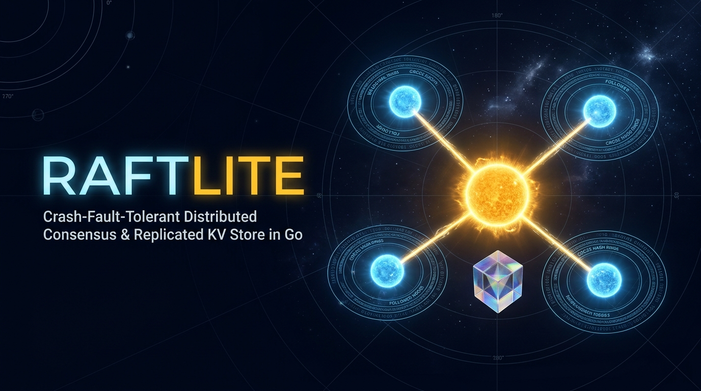
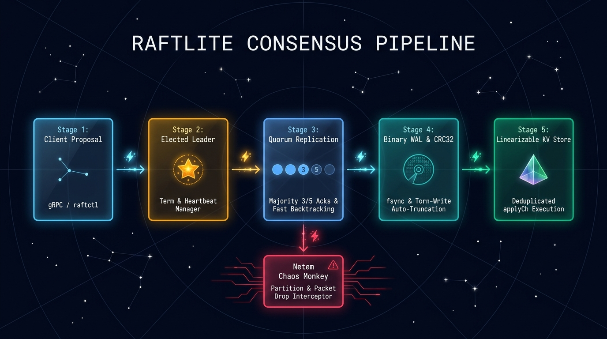

<div align="center">



# RaftLite — Distributed Consensus & Replicated Key-Value Store

[](https://golang.org)
[-F59E0B.svg?style=flat-square)](https://raft.github.io)
[-38BDF8.svg?style=flat-square)]()
[]()
[](LICENSE)

> **High-performance, crash-fault-tolerant (CFT) distributed consensus engine and replicated Key-Value store in Go 1.22—complete Raft implementation with CRC32 binary WAL, term-based accelerated backtracking, linearizable client deduplication, and in-process network chaos injection.**

</div>

---

## Overview

**RaftLite** is a high-performance, crash-fault-tolerant (CFT) distributed consensus engine and replicated Key-Value store implemented in **Go 1.22** using **gRPC** and **Protocol Buffers**.

Engineered for extreme reliability, concurrency safety, and determinism, RaftLite implements the complete Raft consensus specification (Ongaro & Ousterhout) enhanced with production-grade durability: an append-only binary Write-Ahead Log (WAL) with CRC32-IEEE framing, torn write auto-recovery, accelerated term-based log conflict backtracking, linearizable client request deduplication, and an in-process network chaos emulation interceptor (`netem`).

---

## 🏛 Consensus Architecture & Pipeline Workflow

RaftLite processes proposals and achieves distributed consensus through an interconnected 5-stage pipeline backed by in-process chaos testing:

<div align="center">
  
</div>

### Consensus Pipeline Stages:

1. **Stage 1: Client Proposal (`raftctl` / gRPC)**:
   - Client sends atomic command (`Put`, `Get`, `CAS`, `Delete`) to the cluster via gRPC.
   - Non-leader nodes transparently redirect the client to the currently known leader.

2. **Stage 2: Elected Leader (Term & Heartbeat Manager)**:
   - Randomized election timers ($150\text{ms} - 300\text{ms}$) with leak-free channel drainage prevent split-vote deadlocks.
   - Frequent leader heartbeats ($50\text{ms}$) suppress spurious elections while maintaining quorum dominance.
   - Adheres strictly to the **Election Restriction Rule (§5.4.1)**: candidates with stale logs cannot be elected.

3. **Stage 3: Quorum Log Replication & Accelerated Conflict Backtracking**:
   - Leader broadcasts `AppendEntries` RPCs to all peers concurrently.
   - Follower detects log mismatches and returns `conflictTerm` and `conflictFirstIndex`, enabling the leader to bypass entire conflicting terms in a single RPC round-trip.
   - Dynamic majority quorum evaluation ($N/2 + 1$) strictly enforces **Ongaro's Rule (§5.4.2)**: entries from prior terms are *never* committed by replica count alone.

4. **Stage 4: Binary WAL & CRC32 Framing**:
   - Binary framing layout: `[CRC32: 4B | Term: 8B | Index: 8B | Type: 1B | CommandLen: 4B | CommandBytes: NB]`.
   - Synchronous `fsync()` guarantees durability before acknowledging RPCs.
   - Automated startup scanner with torn-write truncation at corrupted frame boundaries.

5. **Stage 5: Linearizable Replicated State Machine (KV Store)**:
   - In-memory key-value engine executes committed log entries sequentially over an asynchronous `applyCh`.
   - Client session deduplication table (`clientId` + `sequenceNum`) caches results to guarantee strictly *exactly-once* execution across retries and leader failovers.

* **In-Process Chaos Monkey (`netem`)**:
  - Intercepts gRPC client and server streams to simulate asymmetric network partitions, arbitrary packet drop rates, and configurable latency/jitter without requiring root OS privileges.

---

## Key Capabilities & Core Innovations

1. **Raft Consensus State Machine:**
   - Formal implementation of **Leader**, **Follower**, and **Candidate** roles.
   - Randomized election timeouts ($150\text{ms} - 300\text{ms}$) with leak-free timer drainage.
   - Frequent leader heartbeats ($50\text{ms}$) to suppress spurious elections.
   - Strict adherence to the **Election Restriction Rule (§5.4.1)**.
2. **Fast Log Conflict Backtracking:**
   - Term-based accelerated backtracking: follower returns `conflictTerm` and `conflictFirstIndex` upon log mismatch, allowing the leader to bypass entire conflicting terms in a single RPC round-trip.
3. **Majority CommitIndex Advancement:**
   - Leader dynamically evaluates peer `matchIndex` medians, strictly enforcing **Ongaro's Rule (§5.4.2)**.
4. **Binary Write-Ahead Log (WAL) with CRC32 Framing:**
   - Append-only binary framing with CRC32-IEEE checksum verification.
   - Synchronous `fsync()` guarantees before acknowledging RPCs.
   - Automated crash scanner with torn-write truncation at corrupted frame boundaries.
5. **Linearizable Replicated State Machine & Client Deduplication:**
   - In-memory key-value engine supporting atomic `Get`, `Put`, `Delete`, and `CAS` (Compare-And-Swap) operations over an asynchronous `applyCh`.
   - Client session deduplication table caching results to guarantee strictly *exactly-once* execution across retries.
6. **Network Chaos & Fault-Injection Harness (`netem`):**
   - In-process gRPC interceptors simulating asymmetric network partitions, arbitrary packet drop rates, and latency jitter.
7. **Production Tooling & Cluster Orchestration:**
   - Main cluster server daemon: `raftd`.
   - Administrative operator and benchmarking utility: `raftctl`.
   - Ready-to-run 3-node and 5-node Docker Compose topologies.

---

## Pre-Build Engineering Documentation

Comprehensive engineering specifications are located in the [`docs/`](docs/) directory:

| Document | Purpose & Contents | Link |
| :--- | :--- | :--- |
| **Product Requirements Document (PRD)** | Problem statement, target personas, product vision, feature requirements matrix, end-to-end request flows, and success metrics. | [PRD.md](docs/PRD.md) |
| **System Architecture Specification** | Tech stack justification, folder structure, binary WAL framing, fast backtracking algorithm, state machine deduplication, and Mermaid diagrams. | [ARCHITECTURE.md](docs/ARCHITECTURE.md) |
| **Security & Threat Model** | CFT vs BFT assumptions, transport security (mTLS, cluster tokens), storage integrity (CRC32), edge cases (split-brain, stale reads), and failure recovery playbook. | [SECURITY.md](docs/SECURITY.md) |
| **Interface Specification** | Complete Protocol Buffers (`raft.proto`, `kv.proto`), gRPC status codes, `raftd` daemon flags, `raftctl` CLI commands, and Docker Compose files. | [INTERFACE_SPEC.md](docs/INTERFACE_SPEC.md) |
| **Feature Tickets & Roadmap** | 13 atomic, sequential implementation tickets with precise AI prompts and verifiable acceptance criteria. | [FEATURE_TICKETS.md](docs/FEATURE_TICKETS.md) |

---

## Quickstart & Deployment

### 1. Prerequisites
- **Go:** `1.22` or later
- **Protocol Buffers Compiler:** `protoc` (v3.20+) and `protoc-gen-go`, `protoc-gen-go-grpc`
- **Docker & Docker Compose:** for containerized multi-node testing

### 2. Building from Source
```bash
# Clone repository
git clone https://github.com/iSHAANphaye/RaftLite.git
cd RaftLite

# Compile Protocol Buffers
make proto

# Build server daemon (raftd) and CLI (raftctl)
make build
```
Binaries will be placed in `bin/raftd` and `bin/raftctl`.

### 3. Launching a 3-Node Cluster via Docker Compose
To start an isolated 3-node RaftLite cluster with persistent storage volumes:
```bash
docker compose -f deploy/docker-compose.3node.yml up -d
```

Verify cluster status using `raftctl`:
```bash
./bin/raftctl --endpoints=localhost:8081 status
```
Output:
```text
Node ID:      node-1
Role:         LEADER
Current Term: 1
Commit Index: 1
Last Applied: 1
Peers (2):
  - node-2 (node-2:9092): matchIndex=1, nextIndex=2 [HEALTHY]
  - node-3 (node-3:9093): matchIndex=1, nextIndex=2 [HEALTHY]
```

### 4. Executing Key-Value Operations
```bash
# Store a key-value pair
./bin/raftctl --endpoints=localhost:8081 put alpha "42"

# Read the value back
./bin/raftctl --endpoints=localhost:8081 get alpha

# Execute an atomic Compare-And-Swap (CAS)
./bin/raftctl --endpoints=localhost:8081 cas alpha "42" "100"

# Delete the key
./bin/raftctl --endpoints=localhost:8081 delete alpha
```

### 5. Running the High-Throughput Benchmarker
Benchmark the cluster under high concurrent load:
```bash
./bin/raftctl bench \
  --endpoints=localhost:8081,localhost:8082,localhost:8083 \
  --clients=32 \
  --duration=30s \
  --write-ratio=1.0
```

---

## Testing & Quality Verification

RaftLite enforces strict zero-tolerance policies for race conditions and data loss:

```bash
# Execute full unit and integration test suite under the Go race detector
go test -v -race -count=1 ./...

# Run 50 continuous rounds of network chaos and leader crash recovery
go test -v -race -run TestClusterChaos ./tests/chaos/...
```

---

## License

This project is licensed under the MIT License — see the [LICENSE](LICENSE) file for details.
