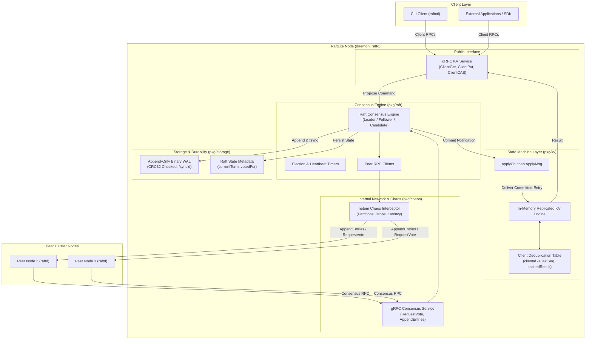
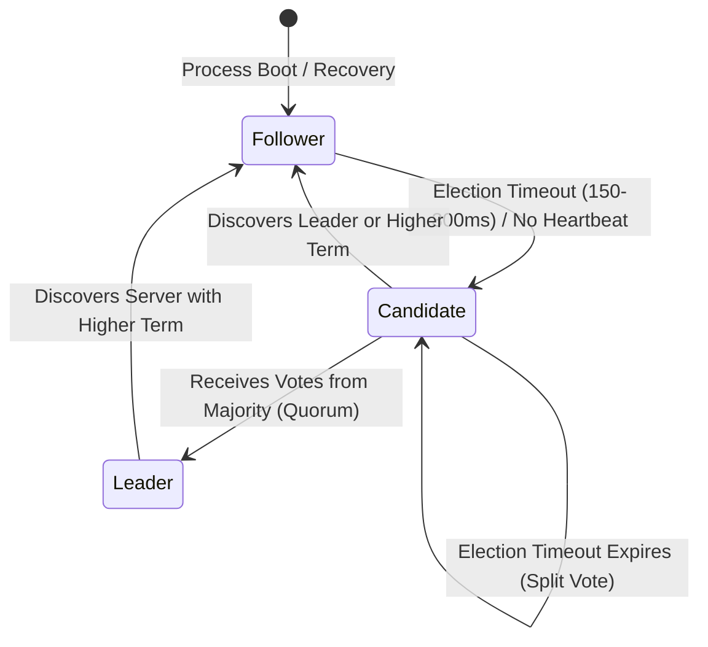
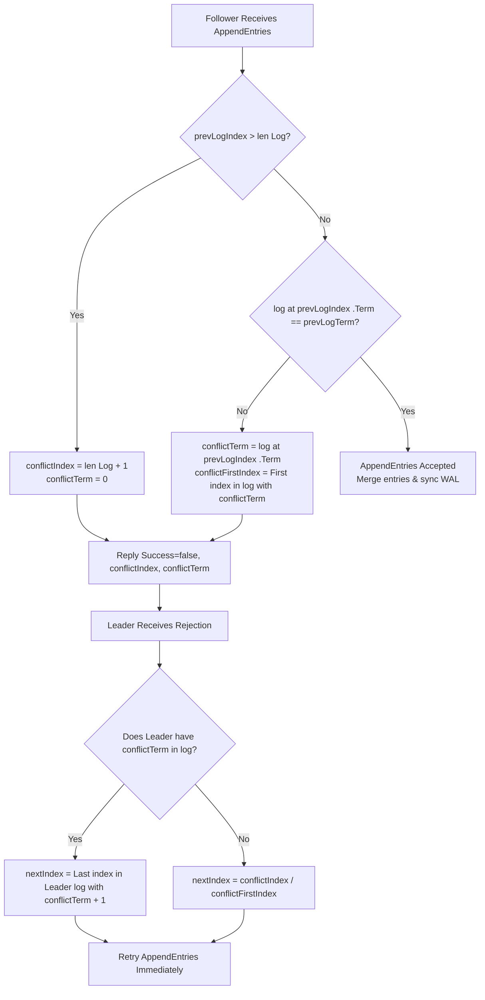
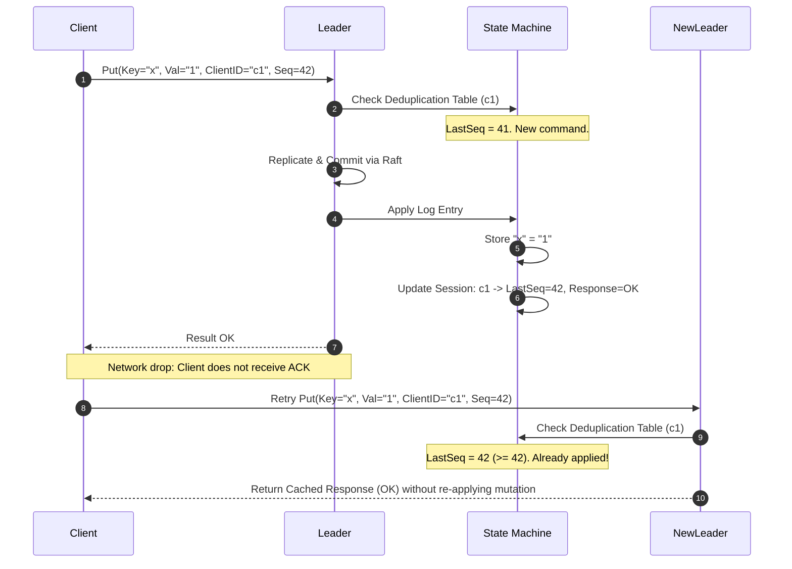
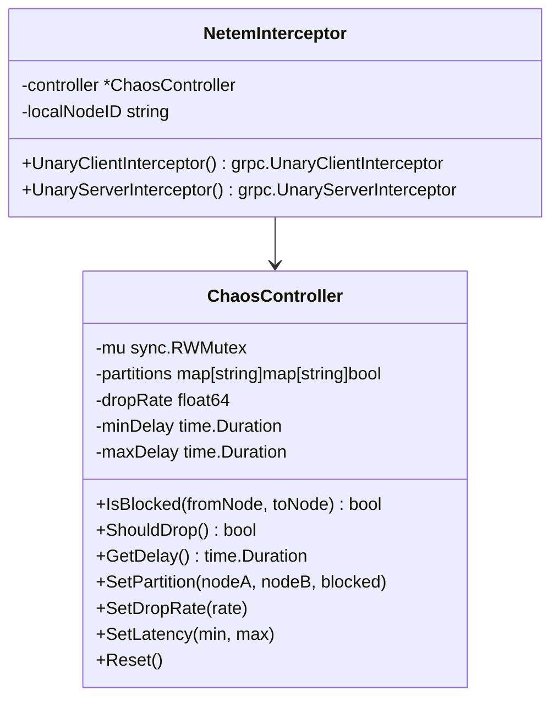

# System Architecture & Technical Specification
## Project: RaftLite — Distributed Consensus & Replicated Key-Value Store
**Document Version:** 1.0.0  
**Target Release:** v1.0-GA  
**Status:** Approved for Implementation  
**Maintainer:** Lead Systems Architect  

---

### 1. High-Level Architectural Overview

RaftLite is organized into modular, decoupled subsystems following clean architecture and Domain-Driven Design (DDD) principles. The system cleanly separates consensus coordination, durable log storage, state machine execution, and networking into discrete layers connected by Go channels and strictly typed interfaces.



---

### 2. Technology Stack & Architectural Decision Records (ADRs)

| Component | Selected Technology | Alternative Considered | Rationale & Architectural Trade-offs |
| :--- | :--- | :--- | :--- |
| **Primary Language** | **Go 1.22** | Rust, C++20, Java | Go offers first-class concurrency primitives (`chan`, `goroutine`), atomic operations (`sync/atomic`), an exceptional memory model, deterministic execution under the race detector (`-race`), and zero runtime dependency friction. |
| **RPC & Serialization** | **gRPC / Protocol Buffers v3** | JSON-RPC, Cap'n Proto, REST | Protobuf delivers high-performance binary packing and rigid type contracts. gRPC provides HTTP/2 multiplexing, streaming heartbeats, and pluggable unary/streaming interceptors for fault injection. |
| **Storage Engine** | **Custom Append-Only Binary WAL** | SQLite, RocksDB, BadgerDB | Direct byte-level framing with CRC32-IEEE checksums eliminates third-party CGo bloat, ensures deterministic sequential disk I/O, gives exact control over `fsync` boundaries, and guarantees zero memory copying. |
| **State Machine** | **In-Memory Map with RWMutex** | LSM Tree, B-Tree | For v1, state resides in memory for microsecond-level query latencies. All state is reconstructed deterministically upon reboot by sequentially replaying committed log entries from the binary WAL. |
| **Testing & Chaos** | **In-Process gRPC Interceptors (`netem`)** | Linux `iptables`, Toxiproxy | In-process interceptors allow deterministic, programmatic fault injection within Go unit and integration tests without requiring `sudo` privileges or external container orchestration during local development. |

---

### 3. File & Folder Structure

```
C:\Antigravity Dev\4 Projects\RaftLite\
├── cmd/
│   ├── raftd/                      # Main daemon binary (cluster node)
│   │   ├── main.go                 # Entrypoint, config parsing, lifecycle management
│   │   └── config.go               # Flags, YAML/Env configuration loader
│   └── raftctl/                    # Administrative CLI & benchmark utility
│       ├── main.go                 # Entrypoint
│       ├── cmd_kv.go               # Subcommands: put, get, cas, delete
│       ├── cmd_status.go           # Subcommands: status, cluster-info
│       └── cmd_bench.go            # Multi-threaded throughput & latency benchmarker
├── proto/
│   └── raftlite/
│       └── v1/
│           ├── raft.proto          # Consensus RPCs (RequestVote, AppendEntries)
│           └── kv.proto            # Client KV RPCs (Get, Put, CAS, Delete, ClusterStatus)
├── pkg/
│   ├── raft/                       # Consensus core implementation
│   │   ├── node.go                 # State machine context, state transitions, event loop
│   │   ├── state.go                # State enum (Follower, Candidate, Leader), invariants
│   │   ├── election.go             # Randomized election timer, RequestVote logic
│   │   ├── replication.go          # AppendEntries broadcasting, heartbeat loop
│   │   ├── log_backtrack.go        # Fast term-based conflict backtracking algorithm
│   │   ├── commit.go               # Majority matchIndex evaluation and commit advancement
│   │   └── types.go                # Internal log entry definitions and channel types
│   ├── storage/                    # Disk persistence and WAL management
│   │   ├── wal.go                  # Binary WAL reader, writer, append, sync
│   │   ├── frame.go                # Binary frame encode/decode, CRC32 verification
│   │   ├── meta.go                 # Persistent metadata store (currentTerm, votedFor)
│   │   └── recover.go              # Torn write detection and automatic truncation
│   ├── kv/                         # Replicated state machine engine
│   │   ├── engine.go               # In-memory key-value store implementation
│   │   ├── session.go              # Client deduplication table (clientId -> seqNum)
│   │   ├── apply.go                # applyCh consumer loop and execution dispatcher
│   │   └── types.go                # Operation types (OpPut, OpGet, OpCAS, OpDelete)
│   ├── chaos/                      # Network emulation and fault injection
│   │   ├── interceptor.go          # gRPC Unary/Stream interceptors
│   │   ├── netem.go                # Partition matrix, packet drop probability, latency jitter
│   │   └── controller.go           # Dynamic partition management API
│   └── cluster/                    # Cluster coordination & peer management
│       ├── peer.go                 # Peer client connection pool and health tracking
│       └── transport.go            # gRPC transport dialer with TLS/token hooks
├── deploy/
│   ├── docker-compose.3node.yml    # 3-node cluster orchestration
│   ├── docker-compose.5node.yml    # 5-node cluster orchestration
│   └── Dockerfile                  # Multi-stage production container build
├── docs/                           # Pre-build engineering specifications
│   ├── PRD.md                      # Product Requirements Document
│   ├── ARCHITECTURE.md             # System Architecture & Technical Specification
│   ├── SECURITY.md                 # Security, Threat Modeling & Chaos Guide
│   ├── INTERFACE_SPEC.md           # Protobuf & CLI Interface Specifications
│   └── FEATURE_TICKETS.md          # Atomic Engineering Build Tickets
├── tests/
│   ├── unit/                       # Fast unit tests for storage, dedup, and election
│   ├── integration/                # End-to-end multi-node consensus tests
│   └── chaos/                      # Automated network partition & crash resilience tests
├── Makefile                        # Build, test, lint, proto generation, and bench commands
├── go.mod                          # Go module definition
└── README.md                       # Developer onboarding and project guide
```

---

### 4. Binary Write-Ahead Log (WAL) Specification

#### 4.1 Record Framing & Layout
The WAL is an append-only binary file consisting of sequential, contiguous frames. Each frame encapsulates an individual log entry protected by an IEEE CRC32 checksum. Integer fields are stored in **Little-Endian** byte order.

```
+-------------------+-------------------+-------------------+-------------------+-------------------+---------------------+
| CRC32 (4 Bytes)   | Term (8 Bytes)    | Index (8 Bytes)   | Type (1 Byte)     | CmdLen (4 Bytes)  | CommandBytes (N B)  |
+-------------------+-------------------+-------------------+-------------------+-------------------+---------------------+
| 0               3 | 4              11 | 12             19 | 20             20 | 21             24 | 25           24 + N |
+-------------------+-------------------+-------------------+-------------------+-------------------+---------------------+
```

#### 4.2 Exact Field Specification
1. **CRC32 Checksum (Bytes 0–3):** `uint32` computed using the standard IEEE polynomial (`crc32.ChecksumIEEE`). The checksum is computed over all subsequent fields of the frame:
   $$\text{CRC32} = \text{CRC32IEEE}(\text{Term} \mathbin{\Vert} \text{Index} \mathbin{\Vert} \text{Type} \mathbin{\Vert} \text{CmdLen} \mathbin{\Vert} \text{CommandBytes})$$
2. **Term (Bytes 4–11):** `uint64` representing the election term during which the entry was proposed.
3. **Index (Bytes 12–19):** `uint64` representing the monotonic 1-based log index of the entry.
4. **Type (Byte 20):** `uint8` representing the entry type:
   - `0x01`: Normal Client Command (`PUT`, `DELETE`, `CAS`).
   - `0x02`: `NOOP` entry (committed upon new leader election to assert term ownership).
   - `0x03`: Cluster Configuration entry (reserved for future membership transitions).
5. **CmdLen (Bytes 21–24):** `uint32` specifying the byte length $N$ of the serialized command payload.
6. **CommandBytes (Bytes 25 to $24+N$):** $N$ raw bytes representing the protobuf-serialized client mutation command (`LogCommand`).

#### 4.3 Disk Synchronization & Atomic Metadata Persistence
To guarantee crash consistency across power loss:
- **WAL Flush:** When a leader appends entries to its local log, it calls `os.File.Sync()` immediately before broadcasting `AppendEntries` to followers. Followers call `os.File.Sync()` *before* acknowledging the RPC.
- **Atomic Metadata Write Path:** The state metadata file (`metadata.json`) stores persistent consensus state: `currentTerm` and `votedFor`. It is written using the strict atomic rename sequence:
  1. Write serialized metadata to a temporary file `metadata.json.tmp`.
  2. Call `tmpFile.Sync()` to force contents to disk.
  3. Atomically rename `metadata.json.tmp` to `metadata.json` via `os.Rename()`.
  4. Open the parent directory and call `dir.Sync()` to guarantee the directory metadata entry is persisted.
- **Monotonic Vote Invariant:** Once a vote is cast and persisted in `metadata.json` for a term, it must **never** be reset, cleared, or overwritten with an empty string during crash recovery. Overwriting `votedFor` on reboot would allow a split-brain condition where a node votes twice in the same term.

#### 4.4 Torn Write Detection and Crash Recovery Algorithm
During node reboot, the storage engine replays the WAL from offset 0 to reconstruct the in-memory log:
1. Open the `.wal` file with `os.O_RDWR`.
2. Seek to byte offset 0.
3. Read the 25-byte fixed frame header. If `io.EOF` is reached on a clean boundary, replay is complete.
4. Extract `CmdLen` ($N$). If the remaining file size is $< N$ bytes, a **torn write** occurred during crash. Truncate the file at the start of this frame (`file.Truncate(lastValidOffset)`) and break.
5. Read $N$ bytes into a buffer.
6. Compute `crc32.ChecksumIEEE` over the payload header and command bytes.
7. Compare calculated CRC with the stored CRC32:
   - **Match:** Add the log entry to the in-memory log slice; advance `lastValidOffset = currentOffset`.
   - **Mismatch:** Data corruption or partial write detected. Seek back to `lastValidOffset`, truncate the file, log a warning, and terminate recovery cleanly.

---

### 5. Raft Consensus Core Design

#### 5.1 State Machine Roles & State Invariants



- **Follower:**
  - Responds to incoming `RequestVote` and `AppendEntries` RPCs.
  - Maintains a randomized election timer ($150\text{ms} \le t \le 300\text{ms}$).
  - Resets election timer upon receiving valid `AppendEntries` from current leader or granting vote to candidate.
  - Transitions to **Candidate** if timer elapses without contact.
- **Candidate:**
  - Increments `currentTerm`.
  - Votes for itself (`votedFor = self`).
  - Persists `currentTerm` and `votedFor` to disk via `fsync`.
  - Resets randomized election timer.
  - Broadcasts `RequestVote` RPCs in parallel to all peers.
  - If votes received $\ge \lfloor N/2 \rfloor + 1$, transitions to **Leader**.
  - If valid `AppendEntries` received from new leader with term $\ge currentTerm$, transitions to **Follower**.
  - If election timer expires without quorum, increments term and restarts election.
- **Leader:**
  - Never votes; rejects `RequestVote` from lower or equal terms.
  - Initializes `nextIndex[p] = lastLogIndex + 1` and `matchIndex[p] = 0` for all peers $p$.
  - Broadcasts immediate empty `AppendEntries` (heartbeat) to assert authority.
  - Sends periodic heartbeats every 50ms.
  - Accepts client mutations, appends them to local log, flushes to disk, and replicates to peers.
  - Advances `commitIndex` upon quorum acknowledgment.

#### 5.2 Election Restriction (Raft §5.4.1)
To prevent a candidate with missing committed entries from overwriting historical logs, a voter rejects a candidate's vote unless the candidate's log is at least as up-to-date as the voter's own log:
```go
func isLogUpToDate(candLastLogTerm, candLastLogIndex, myLastLogTerm, myLastLogIndex uint64) bool {
    if candLastLogTerm != myLastLogTerm {
        return candLastLogTerm > myLastLogTerm
    }
    return candLastLogIndex >= myLastLogIndex
}
```

#### 5.3 Fast Log Conflict Backtracking Algorithm
When a follower's log diverges from the leader's, standard Raft decrements `nextIndex` by 1 per rejected RPC, which can take hundreds of round-trips if logs differ substantially. RaftLite implements the accelerated term-based backtracking protocol:



#### 5.4 Majority CommitIndex Advancement (Raft §5.4.2)
The leader updates `commitIndex` by evaluating the median of `matchIndex`:
1. Find an index $N > \text{commitIndex}$ such that a majority of servers have $\text{matchIndex}[i] \ge N$.
2. **Critical Safety Invariant (§5.4.2):** The leader can only commit log entries from its **current term** by counting replicas. If $\text{log}[N].\text{Term} == \text{currentTerm}$, the leader sets $\text{commitIndex} = N$ and pushes newly committed entries to `applyCh`. Entries from previous terms are committed indirectly once an entry from the current term is committed.

---

### 6. State Machine Replication & Client Deduplication

#### 6.1 Linearizability & Exactly-Once Semantics
To guarantee linearizable reads and writes, the replicated state machine must prevent duplicate executions when clients re-transmit requests following network timeouts or leader failovers.



#### 6.2 Deduplication Session Table (`pkg/kv/session.go`)
- The state machine maintains an in-memory session table:
  ```go
  type ClientSession struct {
      LastSeqNum    uint64
      LastResponse  []byte
      LastUpdatedAt time.Time
  }
  type SessionTable struct {
      mu       sync.RWMutex
      sessions map[string]*ClientSession
  }
  ```
- **Execution Rule:**
  - If $\text{req.SeqNum} \le \text{session.LastSeqNum}$, the operation is skipped and `session.LastResponse` is returned directly.
  - If $\text{req.SeqNum} == \text{session.LastSeqNum} + 1$, the operation is applied to the key-value map, the response cached, and `session.LastSeqNum` updated atomically.
  - If session cache exceeds eviction limit (e.g. 100,000 sessions), oldest inactive sessions are evicted; subsequent retries receive `ErrSessionExpired` rather than executing duplicate mutations.

#### 6.3 Linearizable Reads via ReadIndex (Ongaro §6.4)
To serve client read queries with linearizable consistency without writing full read commands to the WAL:
1. **Current-Term Commit Precondition (Ongaro §6.4):** Upon election, the leader immediately appends a `NOOP` entry (`ENTRY_TYPE_NOOP`) to its log. The leader **cannot** serve ReadIndex queries until this `NOOP` entry (or any entry from its current term) has been committed to quorum. This ensures the leader's `commitIndex` is at least as high as any previous term's committed entries.
2. **ReadIndex Protocol Sequence:**
   - When a `ClientGet` arrives, the leader records `readIndex = commitIndex`.
   - The leader sends a round of heartbeat `AppendEntries` RPCs to all peers and awaits positive acknowledgment from a quorum majority to confirm it has not been deposed by a network partition.
   - The leader awaits state machine advancement until `lastApplied >= readIndex`.
   - The leader reads the value from the state machine under `sync.RWMutex.RLock()` to guarantee thread safety against concurrent `applyCh` executions, and returns the value to the client.
3. **Follower Read Forwarding:** If a follower receives a read request, it forwards the request to the current `leaderHint`, or returns `ErrNotLeader` with the current leader's network address.

---

### 7. Network Chaos & Fault Injection Architecture (`pkg/chaos`)

To rigorously test consensus safety without relying on OS-level root capabilities, RaftLite embeds an in-process network emulation interceptor (`netem`) into the gRPC transport layer.



#### Chaos Emulation Primitives:
1. **Asymmetric Network Partitioning:** Arbitrary matrix defining whether communication from Node $A$ to Node $B$ is dropped:
   ```go
   // Drops RPC if partition matrix disallows traffic
   if controller.IsBlocked(senderID, receiverID) {
       return nil, status.Errorf(codes.Unavailable, "chaos: network partition active")
   }
   ```
2. **Packet Loss Injection:** Simulates lossy connections by dropping a percentage of requests:
   $$\text{Drop If } \text{rand.Float64()} < \text{dropRate}$$
3. **Latency & Jitter Simulation:** Injects randomized sleeping before forwarding requests:
   $$t_{\text{sleep}} = \text{minDelay} + \text{rand}(\text{maxDelay} - \text{minDelay})$$

---

### 8. Cluster Topology & Configuration Management

#### 8.1 Default Cluster Topology
RaftLite deploys in standard odd-numbered cluster quorums (3 or 5 nodes) to achieve optimal fault tolerance:
- **3-Node Cluster:** Tolerates 1 node failure ($F = \lfloor (3-1)/2 \rfloor = 1$). Quorum size = 2.
- **5-Node Cluster:** Tolerates 2 node failures ($F = \lfloor (5-1)/2 \rfloor = 2$). Quorum size = 3.

#### 8.2 Configuration Schema (`cmd/raftd/config.go`)
```yaml
node_id: "node-1"
listen_addr: "0.0.0.0:9091"           # Consensus gRPC port
client_addr: "0.0.0.0:8081"           # Client KV gRPC port
data_dir: "/var/lib/raftlite/data"

election_timeout_min_ms: 150
election_timeout_max_ms: 300
heartbeat_interval_ms: 50

peers:
  - id: "node-2"
    addr: "node-2:9092"
  - id: "node-3"
    addr: "node-3:9093"

storage:
  sync: true                         # Execute fsync on every append
  max_wal_size_mb: 512

chaos:
  enabled: false                     # Enabled during testing & staging
```
