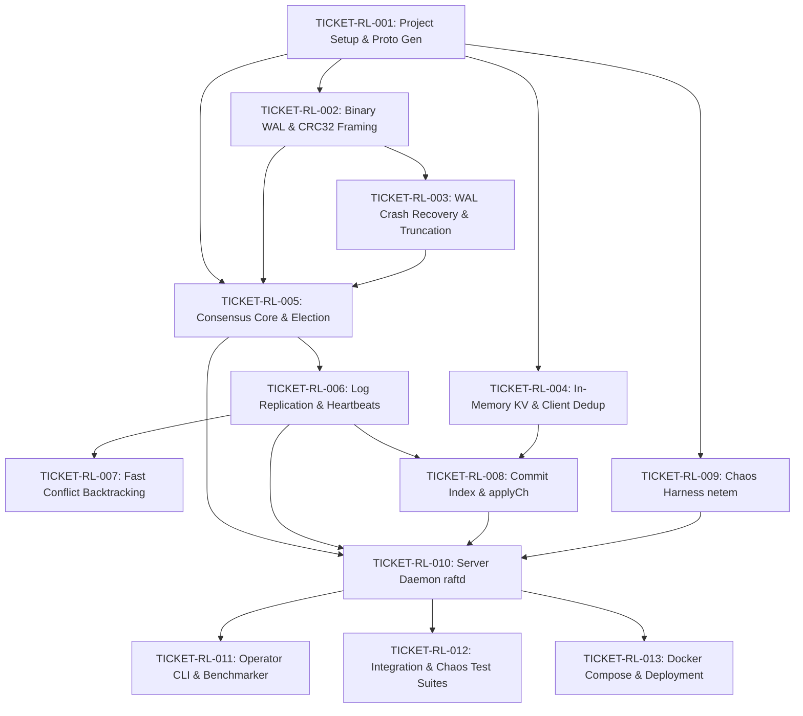

# Engineering Feature Tickets & Implementation Roadmap
## Project: RaftLite — Distributed Consensus & Replicated Key-Value Store
**Document Version:** 1.0.0  
**Target Release:** v1.0-GA  
**Status:** Ready for Development Execution  
**Maintainer:** Lead Systems Architect  

---

### Ticket Overview & Dependency Graph



---

### TICKET-RL-001: Project Setup, Build Pipeline & Protobuf Code Generation
- **Priority:** Must-Have
- **Component:** Build Infrastructure
- **Dependencies:** None
- **Target File Paths:**
  - `go.mod`
  - `proto/raftlite/v1/raft.proto`
  - `proto/raftlite/v1/kv.proto`
  - `Makefile`
  - `.github/workflows/ci.yml`

#### Task Description (AI Coding Prompt)
```text
Initialize the Go 1.22 project structure for RaftLite at 'C:\Antigravity Dev\4 Projects\RaftLite'.
1. Create 'go.mod' with module path 'github.com/raftlite' requiring standard gRPC, Protobuf, and test dependencies:
   - google.golang.org/grpc v1.64.0
   - google.golang.org/protobuf v1.34.1
   - github.com/stretchr/testify v1.9.0
2. Write 'proto/raftlite/v1/raft.proto' and 'proto/raftlite/v1/kv.proto' according to 'docs/INTERFACE_SPEC.md', including full message fields for RequestVote, AppendEntries (with conflict_term and conflict_first_index), ClientPut, ClientGet, ClientCAS, ClientDelete, and ClusterStatus.
3. Write a production 'Makefile' with targets:
   - proto: compile .proto files into pkg/proto/raftlite/v1 using protoc-gen-go and protoc-gen-go-grpc
   - build: build binaries cmd/raftd and cmd/raftctl into bin/
   - test: run 'go test -v -race ./...'
   - lint: run golangci-lint
   - clean: remove build artifacts
4. Create '.github/workflows/ci.yml' executing linting and race-enabled tests on push and pull_request.
```

#### Acceptance Criteria
- [ ] `go.mod` initializes cleanly with Go 1.22 and required dependencies.
- [ ] `proto/raftlite/v1/raft.proto` and `kv.proto` compile without errors via `make proto`.
- [ ] Generated Go protobuf files expose correct typed interfaces and RPC client/server stubs.
- [ ] `Makefile` compiles clean targets without syntax errors.
- [ ] GitHub Actions workflow passes validation syntax.

---

### TICKET-RL-002: Binary Write-Ahead Log (WAL) & Framing Engine with CRC32
- **Priority:** Must-Have
- **Component:** `pkg/storage`
- **Dependencies:** TICKET-RL-001
- **Target File Paths:**
  - `pkg/storage/frame.go`
  - `pkg/storage/wal.go`
  - `pkg/storage/meta.go`
  - `pkg/storage/storage_test.go`

#### Task Description (AI Coding Prompt)
```text
Implement the binary Write-Ahead Log (WAL) storage engine for RaftLite in 'pkg/storage'.
1. In 'pkg/storage/frame.go', define the binary frame layout specified in 'docs/ARCHITECTURE.md':
   - Framing: [CRC32: 4B | Term: 8B | Index: 8B | Type: 1B | CommandLen: 4B | CommandBytes: NB]
   - Little-endian encoding. CRC32 calculated with crc32.ChecksumIEEE over all fields excluding the 4-byte CRC itself.
   - Implement EncodeFrame(entry *LogEntry) ([]byte, error) and DecodeFrame(r io.Reader) (*LogEntry, int64, error).
2. In 'pkg/storage/wal.go', implement type WAL struct with methods:
   - OpenWAL(dir string, sync bool) (*WAL, error)
   - Append(entry *LogEntry) error
   - AppendBatch(entries []*LogEntry) error
   - ReadAll() ([]*LogEntry, error)
   - Truncate(lastIndex uint64) error
   - Close() error
   Ensure that if sync == true, each append calls os.File.Sync().
3. In 'pkg/storage/meta.go', implement persistent metadata storage for currentTerm (uint64) and votedFor (string) using atomic file replacement (temp file write + fsync + os.Rename).
4. In 'pkg/storage/storage_test.go', write tests verifying frame encoding/decoding, CRC verification, sequential appends, and metadata persistence.
```

#### Acceptance Criteria
- [ ] Binary frames conform strictly to the 25-byte fixed header + payload specification.
- [ ] Corrupted bytes in payload or header cause `DecodeFrame` to return an explicit `ErrCRCMismatch`.
- [ ] WAL supports synchronous `Sync()` disk flushes without data corruption.
- [ ] `Truncate(lastIndex)` cleanly removes suffix entries when a leader overwrites follower uncommitted logs.
- [ ] 100% pass rate under `go test -race ./pkg/storage/...`.

---

### TICKET-RL-003: WAL Crash Recovery & Torn Write Truncation
- **Priority:** Must-Have
- **Component:** `pkg/storage`
- **Dependencies:** TICKET-RL-002
- **Target File Paths:**
  - `pkg/storage/recover.go`
  - `pkg/storage/recover_test.go`

#### Task Description (AI Coding Prompt)
```text
Implement the torn write detection and automated recovery scanner for the binary WAL in 'pkg/storage/recover.go'.
1. Implement RecoverWAL(walPath string) (*WAL, []*LogEntry, error):
   - Sequentially read frames from offset 0 to EOF.
   - For each frame, verify complete header availability (25 bytes), payload availability (CommandLen bytes), and validate crc32.ChecksumIEEE.
   - If an unexpected EOF, partial frame header, partial command payload, or CRC32 mismatch is detected:
     a) Treat as a torn write from an abrupt crash/power failure.
     b) Seek to the byte offset of the last known valid frame ('lastValidOffset').
     c) Call os.Truncate(walPath, lastValidOffset) to excise corrupted trailing bytes.
     d) Log the truncation event with byte offset and corrupted index.
     e) Terminate recovery cleanly and return the valid prefix entries.
2. In 'pkg/storage/recover_test.go', write crash simulation tests:
   - Append 10 valid entries, simulate crash by appending 11 random bytes (corrupt header), and verify recovery recovers 10 entries and truncates file.
   - Append 10 valid entries, corrupt 1 bit in entry 10 payload, and verify recovery recovers 9 entries and truncates entry 10.
```

#### Acceptance Criteria
- [ ] Incomplete trailing frames (torn writes) are automatically detected and truncated.
- [ ] Mid-frame CRC corruption triggers truncation at the last valid frame boundary.
- [ ] File size matches the exact byte length of valid frames post-recovery.
- [ ] Recovery tests pass deterministically under `go test -race`.

---

### TICKET-RL-004: In-Memory Replicated Key-Value State Machine & Client Deduplication
- **Priority:** Must-Have
- **Component:** `pkg/kv`
- **Dependencies:** TICKET-RL-001
- **Target File Paths:**
  - `pkg/kv/types.go`
  - `pkg/kv/session.go`
  - `pkg/kv/engine.go`
  - `pkg/kv/apply.go`
  - `pkg/kv/kv_test.go`

#### Task Description (AI Coding Prompt)
```text
Implement the replicated Key-Value state machine and linearizable client deduplication session table in 'pkg/kv'.
1. In 'pkg/kv/types.go', define operation payloads (OpPut, OpGet, OpCAS, OpDelete), command serialization, and ApplyMsg struct.
2. In 'pkg/kv/session.go', implement SessionTable:
   - Store map[string]*ClientSession where ClientSession holds LastSeqNum uint64, LastResponse []byte, and LastUpdated time.Time.
   - Method CheckOrUpdate(clientId string, seqNum uint64, executeFn func() []byte) ([]byte, bool):
     * If seqNum <= session.LastSeqNum: return session.LastResponse and false (duplicate detected).
     * If seqNum > session.LastSeqNum: execute executeFn(), cache result, update LastSeqNum, and return result with true.
3. In 'pkg/kv/engine.go', implement KVEngine:
   - In-memory data store map[string]string protected by sync.RWMutex.
   - Methods: Put(key, val), Get(key), CAS(key, expected, new), Delete(key).
4. In 'pkg/kv/apply.go', implement state machine consumer loop:
   - Listen on applyCh chan ApplyMsg from Raft consensus core.
   - Sequentially decode commands, pass through SessionTable, apply to KVEngine, and notify waiting client response channels.
5. In 'pkg/kv/kv_test.go', write unit tests validating CAS semantics, client deduplication across retried requests, and concurrent read/write operations.
```

#### Acceptance Criteria
- [ ] CAS operations execute atomically with correct expected/new value semantics.
- [ ] Duplicate client requests with identical `(clientId, sequenceNum)` return cached responses without re-executing mutations.
- [ ] Out-of-order sequence numbers are rejected or handled idempotently.
- [ ] Zero race conditions under `go test -race ./pkg/kv/...`.

---

### TICKET-RL-005: Raft Consensus Core: Roles, Randomized Election Timers & RequestVote RPC
- **Priority:** Must-Have
- **Component:** `pkg/raft`
- **Dependencies:** TICKET-RL-002, TICKET-RL-003
- **Target File Paths:**
  - `pkg/raft/types.go`
  - `pkg/raft/state.go`
  - `pkg/raft/election.go`
  - `pkg/raft/node.go`
  - `pkg/raft/election_test.go`

#### Task Description (AI Coding Prompt)
```text
Implement the core Raft node lifecycle, state roles (Follower, Candidate, Leader), randomized election timers, and RequestVote RPC handling in 'pkg/raft'.
1. In 'pkg/raft/state.go', define NodeRole (RoleFollower, RoleCandidate, RoleLeader) and NodeState struct protecting term, votedFor, commitIndex, lastApplied, and log slice with sync.Mutex.
2. In 'pkg/raft/election.go':
   - Implement randomized election timer: 150ms + rand(150ms) = 150ms..300ms using time.NewTimer with proper Stop/drain pattern to prevent memory leaks.
   - When election timer fires, transition Follower -> Candidate:
     a) Increment currentTerm.
     b) Vote for self (votedFor = selfNodeID).
     c) Persist term and votedFor to storage (fsync).
     d) Reset election timer.
     e) Broadcast RequestVote RPCs to all peers concurrently.
   - Candidate vote tallying: if votes >= floor(N/2) + 1, transition Candidate -> Leader.
3. In RequestVote handler:
   - Reject if req.Term < currentTerm.
   - If req.Term > currentTerm, update currentTerm, set state = Follower, clear votedFor.
   - Apply Election Restriction rule (Raft §5.4.1): candidate's log must be as up-to-date as receiver's log. Check lastLogTerm first, then lastLogIndex.
   - If votedFor is null or candidateId, and log is up-to-date: grant vote, update votedFor, persist to storage, and reset election timer.
4. In 'pkg/raft/election_test.go', write unit tests verifying election timeout triggering, candidate quorum transitions, split-vote resolution, and election restriction enforcement.
```

#### Acceptance Criteria
- [ ] Election timer values are uniformly randomized within the 150ms–300ms window.
- [ ] Timers do not leak goroutines or channels upon rapid resets.
- [ ] Candidate with stale log cannot receive votes from a node with a more up-to-date log (§5.4.1).
- [ ] Nodes persist `currentTerm` and `votedFor` to disk before replying to `RequestVote`.
- [ ] Race detector passes cleanly on 50 iterations of election tests.

---

### TICKET-RL-006: Raft Consensus Replication: AppendEntries & Heartbeat Loop
- **Priority:** Must-Have
- **Component:** `pkg/raft`
- **Dependencies:** TICKET-RL-005
- **Target File Paths:**
  - `pkg/raft/replication.go`
  - `pkg/raft/replication_test.go`

#### Task Description (AI Coding Prompt)
```text
Implement the log replication pipeline and heartbeat loop in 'pkg/raft/replication.go'.
1. Upon becoming Leader:
   - Initialize nextIndex[p] = lastLogIndex + 1 and matchIndex[p] = 0 for all peers.
   - Broadcast an immediate heartbeat AppendEntries (empty entries) to suppress other elections.
   - Start background ticker firing heartbeats every 50ms.
2. In AppendEntries RPC sender:
   - For each peer, calculate prevLogIndex = nextIndex[p] - 1 and prevLogTerm = log[prevLogIndex].Term.
   - Slice entries to replicate: log[nextIndex[p] : ].
   - Send AppendEntriesRequest concurrently to all peers.
3. In AppendEntries RPC receiver (Follower):
   - Reject if req.Term < currentTerm.
   - If req.Term > currentTerm, convert to Follower, update currentTerm, clear votedFor.
   - Reset local election timer (valid leader confirmed).
   - Verify log consistency: if len(log) < req.PrevLogIndex or log[req.PrevLogIndex].Term != req.PrevLogTerm, return success = false.
   - If an existing entry conflicts with a new entry (same index, different terms), truncate the existing entry and all following entries from log and WAL.
   - Append any new entries not already in the log to WAL and in-memory log, and call fsync().
4. In 'pkg/raft/replication_test.go', write tests verifying log synchronization, heartbeat delivery, and follower log replacement on term conflicts.
```

#### Acceptance Criteria
- [ ] Leader sends periodic heartbeats every 50ms, resetting follower election timers.
- [ ] Followers correctly verify `prevLogIndex` and `prevLogTerm` consistency.
- [ ] Conflicting uncommitted entries in follower logs are truncated and replaced.
- [ ] `go test -race ./pkg/raft/...` passes without warnings.

---

### TICKET-RL-007: Fast Log Conflict Backtracking Algorithm
- **Priority:** Must-Have
- **Component:** `pkg/raft`
- **Dependencies:** TICKET-RL-006
- **Target File Paths:**
  - `pkg/raft/log_backtrack.go`
  - `pkg/raft/backtrack_test.go`

#### Task Description (AI Coding Prompt)
```text
Implement the term-based fast log conflict backtracking algorithm in 'pkg/raft/log_backtrack.go' as defined in 'docs/ARCHITECTURE.md'.
1. Update Follower AppendEntries rejection logic:
   - Case 1 (Follower log too short): If len(log) < req.PrevLogIndex:
     * Set conflict_term = 0
     * Set conflict_first_index = len(log) + 1
   - Case 2 (Term mismatch): If len(log) >= req.PrevLogIndex but log[req.PrevLogIndex].Term != req.PrevLogTerm:
     * Set conflict_term = log[req.PrevLogIndex].Term
     * Search backward to find the first index in follower's log that has conflict_term.
     * Set conflict_first_index = firstIndexWithTerm
2. Update Leader AppendEntries response handling:
   - If response.Success == false:
     * If response.ConflictTerm == 0:
       nextIndex[p] = response.ConflictFirstIndex
     * Else (follower has conflicting term):
       Search leader's own log for response.ConflictTerm:
       - If leader finds entries with ConflictTerm: set nextIndex[p] = last index of that term + 1
       - If leader does not have ConflictTerm: set nextIndex[p] = response.ConflictFirstIndex
     * Enforce boundary: nextIndex[p] = max(1, nextIndex[p])
     * Trigger immediate retry of AppendEntries for peer p without waiting for next heartbeat tick.
3. In 'pkg/raft/backtrack_test.go', construct scenarios with 100+ conflicting entries across 5 terms, and verify that leader resolves conflict and synchronizes follower in fewer than 6 RPC round-trips.
```

#### Acceptance Criteria
- [ ] Log divergence spanning multiple terms is reconciled in $O(\text{number of conflicting terms})$ RPCs rather than $O(\text{number of entries})$ RPCs.
- [ ] Missing index gaps update `nextIndex` directly to the follower's log length.
- [ ] Backtrack unit tests verify exact `nextIndex` calculations.
- [ ] Zero race conditions under `go test -race`.

---

### TICKET-RL-008: Majority CommitIndex Advancement & applyCh Pipeline
- **Priority:** Must-Have
- **Component:** `pkg/raft`
- **Dependencies:** TICKET-RL-004, TICKET-RL-006
- **Target File Paths:**
  - `pkg/raft/commit.go`
  - `pkg/raft/commit_test.go`

#### Task Description (AI Coding Prompt)
```text
Implement majority commit index advancement and the applyCh delivery pipeline in 'pkg/raft/commit.go'.
1. In leader response handler after successful AppendEntries:
   - Update matchIndex[p] = req.PrevLogIndex + len(req.Entries) and nextIndex[p] = matchIndex[p] + 1.
   - Evaluate median of matchIndex across all nodes (including leader itself where matchIndex[self] = len(log)).
   - Find candidate index N > commitIndex such that majority of matchIndex[i] >= N.
   - Enforce Raft §5.4.2 Invariant: Check log[N].Term == currentTerm. If true, advance commitIndex = N. (Entries from previous terms are NEVER committed by replica count alone).
2. Implement applyCh pipeline:
   - Background goroutine monitors commitIndex > lastApplied.
   - For each index from lastApplied + 1 up to commitIndex:
     * Construct ApplyMsg{CommandIndex: idx, CommandTerm: log[idx].Term, Command: log[idx].Data}.
     * Send ApplyMsg to applyCh.
     * Advance lastApplied = idx.
3. In follower AppendEntries:
   - If req.LeaderCommit > commitIndex:
     * Advance commitIndex = min(req.LeaderCommit, lastLogIndex).
     * Trigger applyCh delivery up to new commitIndex.
4. In 'pkg/raft/commit_test.go', write tests verifying:
   - Majority replication advances commitIndex.
   - Previous-term entries are not committed until a current-term entry is committed (§5.4.2 figure 8 scenario).
   - applyCh delivers entries strictly sequentially without gaps or duplicates.
```

#### Acceptance Criteria
- [ ] CommitIndex advances if and only if a quorum acknowledges entries and `log[N].Term == currentTerm`.
- [ ] Entries are delivered to `applyCh` in exact monotonic index order.
- [ ] Figure 8 uncommitted overwrite scenario is prevented.
- [ ] Race detector passes cleanly on concurrent commit tests.

---

### TICKET-RL-009: Chaos & Network Fault Harness (`netem`)
- **Priority:** Must-Have
- **Component:** `pkg/chaos`
- **Dependencies:** TICKET-RL-001
- **Target File Paths:**
  - `pkg/chaos/controller.go`
  - `pkg/chaos/netem.go`
  - `pkg/chaos/interceptor.go`
  - `pkg/chaos/chaos_test.go`

#### Task Description (AI Coding Prompt)
```text
Build the in-process network emulation and chaos fault-injection interceptor in 'pkg/chaos'.
1. In 'pkg/chaos/controller.go', implement ChaosController:
   - Thread-safe partition matrix map[string]map[string]bool indicating whether traffic from src to dst is blocked.
   - Configurable dropRate float64 (0.0 to 1.0) for random packet drops.
   - Configurable minDelay, maxDelay time.Duration for latency and jitter injection.
   - Methods:
     * PartitionNodes(groupA []string, groupB []string)
     * HealAll()
     * SetPacketDrop(rate float64)
     * SetLatency(min, max time.Duration)
     * IsBlocked(from, to string) bool
2. In 'pkg/chaos/interceptor.go', implement gRPC interceptors:
   - UnaryClientInterceptor and StreamClientInterceptor that extract target peer from context/metadata.
   - If IsBlocked(localNode, remoteNode), return status.Errorf(codes.Unavailable, "chaos: partition").
   - If rand.Float64() < dropRate, return status.Errorf(codes.DeadlineExceeded, "chaos: packet dropped").
   - If delay > 0, sleep for randomized jitter duration before invoking handler.
3. In 'pkg/chaos/chaos_test.go', verify programmatic creation of split networks, packet drop rates, and latency injection without panics or deadlocks.
```

#### Acceptance Criteria
- [ ] `PartitionNodes` cleanly blocks bidirectional traffic between specified node groups.
- [ ] Interceptors return standard gRPC error codes (`Unavailable`, `DeadlineExceeded`).
- [ ] Latency injection introduces measurable sleep durations without race conditions.
- [ ] `go test -race ./pkg/chaos/...` passes.

---

### TICKET-RL-010: Node Server Daemon (`raftd`) & gRPC Transport Layer
- **Priority:** Must-Have
- **Component:** `cmd/raftd`, `pkg/cluster`
- **Dependencies:** TICKET-RL-004, TICKET-RL-007, TICKET-RL-008, TICKET-RL-009
- **Target File Paths:**
  - `pkg/cluster/peer.go`
  - `pkg/cluster/transport.go`
  - `cmd/raftd/config.go`
  - `cmd/raftd/main.go`

#### Task Description (AI Coding Prompt)
```text
Implement the server daemon binary 'raftd' and cluster peer networking layer.
1. In 'pkg/cluster/transport.go' and 'peer.go':
   - Manage gRPC connection pools to peer nodes with keepalive, backoff, and optional chaos interceptors.
   - Implement cluster token verification interceptor (checking 'x-raftlite-cluster-token').
2. In 'cmd/raftd/config.go':
   - Parse CLI flags and environment variables matching 'docs/INTERFACE_SPEC.md' (node-id, listen-addr, client-addr, peers, data-dir, election timeouts, sync, token).
3. In 'cmd/raftd/main.go' and 'pkg/kv/server.go':
   - Initialize WAL storage engine and run crash recovery with torn-write truncation.
   - Initialize in-memory KV engine and applyCh consumer.
   - Start Raft consensus engine with configured peers.
   - Implement Linearizable ReadIndex protocol in KVService.Get (verify current-term NOOP committed, check readIndex = commitIndex, confirm quorum heartbeat, await lastApplied >= readIndex).
   - Register RaftService on listen-addr and KVService on client-addr.
   - Listen for OS signals (SIGINT, SIGTERM) to execute graceful shutdown (flush WAL, close connections).
```

#### Acceptance Criteria
- [ ] `raftd` launches, parses config/env variables, and binds to specified gRPC ports.
- [ ] Peer connections re-dial automatically with exponential backoff on connection drops.
- [ ] Graceful shutdown cleanly closes open WAL files and stops election loops.
- [ ] Verified via manual launch of 3 independent instances.

---

### TICKET-RL-011: Operator CLI, Client SDK & Benchmark Load Generator (`raftctl`)
- **Priority:** Must-Have
- **Component:** `cmd/raftctl`
- **Dependencies:** TICKET-RL-010
- **Target File Paths:**
  - `cmd/raftctl/main.go`
  - `cmd/raftctl/cmd_kv.go`
  - `cmd/raftctl/cmd_status.go`
  - `cmd/raftctl/cmd_bench.go`

#### Task Description (AI Coding Prompt)
```text
Implement the administrative CLI and benchmark utility 'raftctl' matching 'docs/INTERFACE_SPEC.md'.
1. In 'cmd/raftctl/main.go': Setup root command with global flags (--endpoints, --timeout, --token, --json).
2. In 'cmd/raftctl/cmd_kv.go': Implement subcommands:
   - put <key> <val>: calls ClientPut RPC.
   - get <key>: calls ClientGet RPC.
   - cas <key> <expected> <new>: calls ClientCAS RPC.
   - delete <key>: calls ClientDelete RPC.
   If target node returns leader_hint, client automatically retries against the leader.
3. In 'cmd/raftctl/cmd_status.go': Query ClusterStatus RPC and print human-readable table (or JSON if --json).
4. In 'cmd/raftctl/cmd_bench.go': Implement high-concurrency load generator:
   - Spawn N worker goroutines issuing requests for specified duration.
   - Measure total ops, ops/sec, error count, and compute latency percentiles (P50, P90, P99, Max).
   - Display formatted summary output as defined in 'docs/INTERFACE_SPEC.md'.
```

#### Acceptance Criteria
- [ ] `raftctl` handles `put`, `get`, `cas`, `delete`, and `status` with automatic leader redirection.
- [ ] Output conforms to JSON when `--json` flag is supplied.
- [ ] `bench` command runs concurrently with configurable client workers and outputs accurate latency percentiles.

---

### TICKET-RL-012: Multi-Node Integration & Chaos Jepsen-Style Test Suites
- **Priority:** Must-Have
- **Component:** `tests/`
- **Dependencies:** TICKET-RL-010, TICKET-RL-011
- **Target File Paths:**
  - `tests/integration/cluster_test.go`
  - `tests/chaos/partition_test.go`
  - `tests/chaos/crash_test.go`

#### Task Description (AI Coding Prompt)
```text
Create integration and chaos test suites to validate RaftLite under real network and failure conditions.
1. In 'tests/integration/cluster_test.go':
   - Spin up in-process 3-node and 5-node clusters.
   - Test basic election, leader failover on leader termination, and log replication.
   - Test linearizability: feed concurrent client operations into Porcupine linearizability checker (or sequential history checker) to mathematically prove linearizable consistency (no stale reads, no out-of-order writes) during active leader failover.
   - Verify client duplicate requests are suppressed via deduplication session table.
2. In 'tests/chaos/partition_test.go':
   - Create 5-node cluster. Partition nodes into {N1, N2} and {N3, N4, N5}.
   - Assert majority partition {N3, N4, N5} elects leader and commits writes.
   - Assert minority partition {N1, N2} cannot commit writes.
   - Heal partition. Assert all 5 nodes reconcile logs to the majority's history without data loss.
3. In 'tests/chaos/crash_test.go':
   - Run 50 continuous cycles of writing keys while randomly killing nodes with SIGKILL.
   - Restart crashed nodes, wait for election, and verify that 100% of acknowledged writes persist without corruption.
```

#### Acceptance Criteria
- [ ] Cluster passes 3-node and 5-node leader failover tests in $< 150$ms.
- [ ] Asymmetric network partition tests verify zero split-brain and zero uncommitted log divergence.
- [ ] 50 rounds of random node kills result in 0 lost committed entries.
- [ ] `go test -race -v ./tests/...` passes 100%.

---

### TICKET-RL-013: Docker Compose Multi-Node Deployment & Production Containerization
- **Priority:** Should-Have
- **Component:** `deploy/`
- **Dependencies:** TICKET-RL-010, TICKET-RL-011
- **Target File Paths:**
  - `deploy/Dockerfile`
  - `deploy/docker-compose.3node.yml`
  - `deploy/docker-compose.5node.yml`

#### Task Description (AI Coding Prompt)
```text
Create containerization and deployment configurations for RaftLite clusters.
1. Write 'deploy/Dockerfile':
   - Multi-stage build using golang:1.22-alpine as builder.
   - Compile 'raftd' and 'raftctl' with CGO_ENABLED=0 -ldflags="-s -w".
   - Minimal runtime image based on alpine:latest (or gcr.io/distroless/static-debian12).
   - Set ENTRYPOINT to /usr/local/bin/raftd.
2. Write 'deploy/docker-compose.3node.yml' and 'deploy/docker-compose.5node.yml' matching the exact specifications in 'docs/INTERFACE_SPEC.md', including persistent named volumes and custom bridge networks.
```

#### Acceptance Criteria
- [ ] Docker image builds successfully with final size $< 25$MB.
- [ ] `docker compose -f deploy/docker-compose.3node.yml up -d` starts a healthy 3-node cluster.
- [ ] Nodes discover peers, elect a leader, and process `raftctl` requests across mapped ports.
