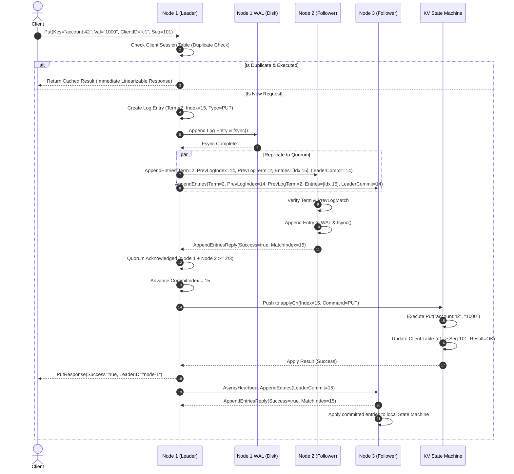
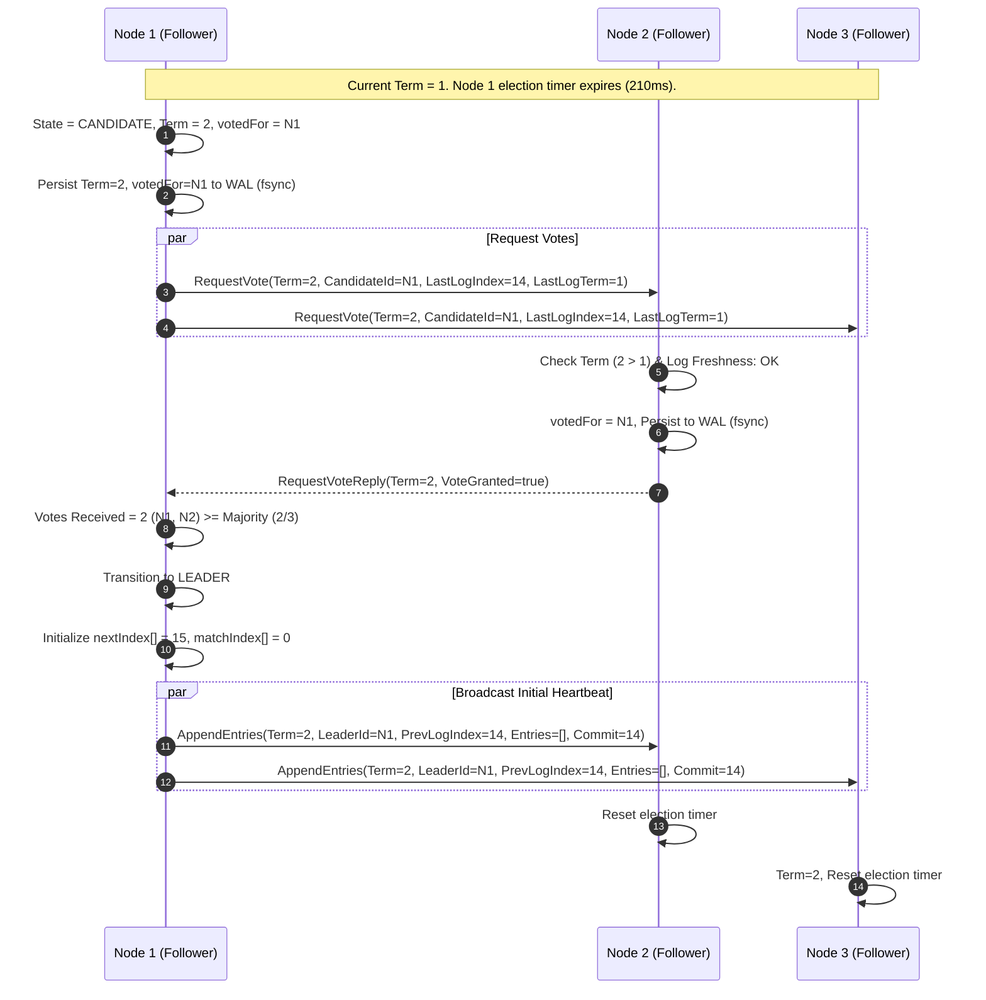
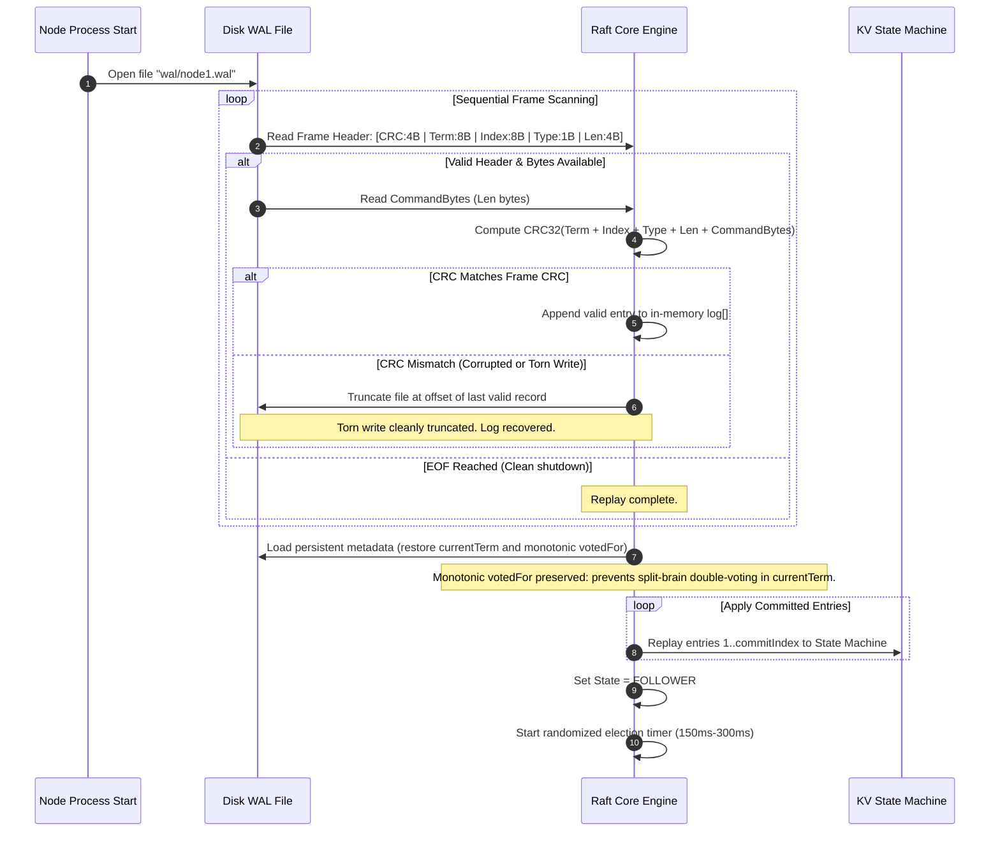

# Product Requirements Document (PRD)
## Project: RaftLite — Distributed Consensus & Replicated Key-Value Store
**Document Version:** 1.0.0  
**Target Release:** v1.0-GA  
**Status:** Approved for Implementation  
**Maintainer:** Lead Systems Architect & Product Manager  

---

### 1. Executive Summary & Problem Statement

#### 1.1 The Fundamental Challenge of Distributed Consistency
Building distributed storage systems that remain both available and consistent in the presence of unreliable networks, machine crashes, hardware degradation, and unpredictable packet delays is one of the hardest problems in software engineering. When multiple nodes cooperate to maintain shared state, simple replication techniques fail due to:
- **Network Partitions & Asymmetric Connectivity:** Routers fail, cables degrade, and packet filtering creates isolated subgroups. Without rigorous consensus, network partitions cause **split-brain scenarios**, where two isolated nodes both believe they are the legitimate leader, accept diverging writes, and corrupt permanent records.
- **Node Failures & Crash-Reboot Semantics:** Nodes can crash at any arbitrary instruction—including midway through a disk write (torn write) or immediately after acknowledging an RPC. Upon restart, a node must reconstruct its exact state without corrupting historical agreements.
- **Message Loss, Reordering, and Duplication:** Distributed networks do not guarantee FIFO delivery. Stale RPCs from dead leaders can arrive seconds later; duplicate client requests can inadvertently execute side-effecting operations multiple times.

#### 1.2 The Existing Landscape vs. The RaftLite Solution
Industry standard consensus libraries like `etcd/raft` and HashiCorp Serf/Raft are battle-tested but suffer from extreme architectural overhead, sprawling dependencies, complex callback abstractions, and hundreds of thousands of lines of code. This makes them difficult to audit, customize, benchmark, or study. Conversely, educational snippets (such as MIT 6.824 starter labs) omit crucial production necessities:
- They store logs in memory without durable binary Write-Ahead Logs (WAL).
- They lack CRC32 disk corruption detection and torn-write auto-recovery.
- They lack client request deduplication (violating linearizability across leader failovers).
- They lack integrated network chaos and fault-injection harnesses.

**RaftLite** bridges this chasm. It is a high-performance, crash-fault-tolerant (CFT) distributed consensus engine and replicated Key-Value store built in Go 1.22. RaftLite implements the complete Raft consensus protocol as defined by Ongaro & Ousterhout (Stanford University), equipped with an immutable binary disk WAL, term-based fast log conflict backtracking, linearizable client deduplication sessions, and an injectable gRPC network chaos interceptor.

---

### 2. Target Users & Personas

| Persona | Primary Goals | How RaftLite Delivers |
| :--- | :--- | :--- |
| **Distributed Systems Engineers** | Building high-reliability coordination primitives, distributed lock managers, and consensus backbones. | Provides a clean, idiomatic Go 1.22 codebase with explicit state machines, zero hidden magic, and full gRPC/Protobuf contracts. |
| **Database & Storage Architects** | Designing replicated transactional databases, WAL engines, and log replication layers. | Provides a production-grade binary WAL format with byte-level framing, CRC32 verification, and synchronous `fsync` semantics. |
| **Infrastructure & SRE Teams** | Validating high-availability clusters, automated failover, and fault-injection scenarios. | Includes a fully integrated chaos proxy interceptor (`netem`), Docker Compose multi-node environments, and automated Jepsen-style partition testing. |
| **Systems Researchers & Learners** | Understanding protocol edge cases (uncommitted log overwrites, election restrictions, fast log backtracking). | Implements the Raft specification with mathematical fidelity, accompanied by exhaustive sequence diagrams and trace logging. |

---

### 3. Product Vision & Guiding Principles

1. **Correctness Above All Else:** Consensus algorithms cannot tolerate "occasional" bugs. State transitions must strictly adhere to Raft safety invariants (§5.2, §5.4). Every log append and commit advancement must be formally verified under race conditions (`go test -race`).
2. **Durability by Default:** A node shall never acknowledge an RPC or advance its commit index based on volatile memory. All term changes, vote grants, and log entries must be flushed to disk via `fsync` prior to responding.
3. **Linearizability & Client Deduplication:** Clients must observe strong consistency. Write operations (`Put`, `CAS`, `Delete`) must execute exactly once, even when clients retry across network drops or cluster leader failovers.
4. **Observable Chaos Resiliency:** Faults must be first-class citizens. The system must natively support asymmetric network partitions, arbitrary packet drop rates, and leader `SIGKILL` without suffering committed data loss or deadlocks.
5. **Zero External Runtime Dependencies:** RaftLite requires only a standard Go runtime and disk storage; it does not depend on CGo, external key-value engines, or third-party coordination tools.

---

### 4. Core Features & Capabilities Matrix

| Feature ID | Capability | Priority | Component | Functional Description & Rationale |
| :--- | :--- | :--- | :--- | :--- |
| **FEAT-001** | **Raft Consensus Core** | **Must-Have** | `pkg/raft` | Full implementation of Leader, Follower, and Candidate state machine. Randomized election timeouts (150ms–300ms) to prevent split votes; periodic heartbeats (50ms). Strict implementation of election restriction (§5.4.1) ensuring candidates with stale logs cannot be elected. |
| **FEAT-002** | **Fast Log Conflict Backtracking** | **Must-Have** | `pkg/raft` | Accelerated term-based log conflict resolution. When an `AppendEntries` rejection occurs, the follower returns `conflictTerm` and `conflictFirstIndex`, allowing the leader to bypass entire conflicting terms in a single RPC round-trip rather than decrementing `nextIndex` by 1. |
| **FEAT-003** | **Majority Commit Index Advancement** | **Must-Have** | `pkg/raft` | Leader dynamically tracks `matchIndex` across all peers and advances `commitIndex` to the median match index $N$, subject to Raft §5.4.2 rule: the leader *never* commits log entries from previous terms by counting replicas; entries must belong to the leader's `currentTerm`. |
| **FEAT-004** | **Persistent Storage & Binary WAL** | **Must-Have** | `pkg/storage` | Crash-durable, append-only binary Write-Ahead Log. Fixed record framing: `[CRC32: 4B \| Term: 8B \| Index: 8B \| Type: 1B \| CommandLen: 4B \| CommandBytes: NB]`. Synchronous `fsync` executed before returning from state mutations. Automatic truncation of torn writes on crash recovery. |
| **FEAT-005** | **Replicated KV State Machine** | **Must-Have** | `pkg/kv` | In-memory key-value engine driven strictly by consensus `applyCh`. Supports atomic operations: `Get(key)`, `Put(key, value)`, `Delete(key)`, and `CAS(key, expectedVal, newVal)`. |
| **FEAT-006** | **Linearizable Client Request Deduplication** | **Must-Have** | `pkg/kv` | Client request deduplication session table indexed by `clientId`. Maintains the highest processed `sequenceNum` and cached response. Prevents duplicate command execution when clients retry across network drops or leader failovers. |
| **FEAT-007** | **Network Chaos & Fault Harness (`netem`)** | **Must-Have** | `pkg/chaos` | Intercepting gRPC client/server middleware simulating asymmetric network partitions, directional packet dropping, artificial latency/jitter, and partitioned quorums. Allows programmatic verification of split-brain resilience. |
| **FEAT-008** | **Multi-Node Cluster Deployment** | **Must-Have** | `deploy/` | Production-ready Docker Compose configurations for 3-node and 5-node cluster topologies with isolated bridge networks, health checks, and mounted persistent storage volumes. |
| **FEAT-009** | **Operator CLI & Load Generator (`raftctl`)** | **Must-Have** | `cmd/raftctl` | Administrative command-line utility supporting KV operations (`put`, `get`, `cas`, `delete`), cluster status inspection (`status`), and a multi-threaded throughput/latency benchmark engine (`bench`). |
| **FEAT-010** | **Log Compaction & Snapshotting** | *Nice-to-Have (Phase 2)* | `pkg/raft` | Log truncation and snapshot transfer (`InstallSnapshot` RPC) to bound WAL disk growth and accelerate lagging node catch-up. Deferred to Phase 2. |
| **FEAT-011** | **Dynamic Cluster Membership Changes** | *Out-of-Scope (v1)* | `pkg/raft` | Joint consensus configuration changes ($C_{old} \to C_{old,new} \to C_{new}$). Clusters in v1 are statically configured via configuration files. |

---

### 5. Detailed End-to-End Application Flows

#### 5.1 End-to-End Client Write Flow (`ClientPut`)

#### 5.2 Leader Election & Split-Vote Resolution Flow

#### 5.3 Crash Recovery & Torn Write Truncation Flow

---

### 6. Success Metrics & Non-Functional Benchmarks

To be certified as production-ready, RaftLite must satisfy the following verifiable quantitative criteria:

| Category | Metric | Target Threshold | Verification Procedure |
| :--- | :--- | :--- | :--- |
| **Concurrency Safety** | Race Condition Detector | **Zero race warnings** | `go test -race -count=50 ./...` across all packages under high concurrency load. |
| **High Availability** | Leader Failover Latency | **< 150 milliseconds** | In a 5-node cluster, kill the leader with `kill -9`. Measure time until a client write succeeds on the new leader. |
| **Consensus Safety** | Data Loss Under Chaos | **0 lost committed entries** | Run 50 continuous rounds of randomized network partitions and leader SIGKILLs using `pkg/chaos`. Zero committed writes may be dropped or overwritten. |
| **Linearizability** | Client Duplicate Prevention | **100% duplicate suppression** | Fire 10,000 requests with 30% intentional client-side duplicate retries. Assert identical state machine sequence and exact single execution of CAS operations. |
| **Write Throughput** | Single-Node Disk Throughput | **> 3,000 ops/sec** (Individual `fsync`) **> 25,000 ops/sec** (Group commit batching) | Measured via `raftctl bench --clients=32 --duration=30s` targeting a 3-node cluster with NVMe SSD backing. |
| **P99 Read Latency** | Linearizable Get Latency | **< 5 milliseconds** | Measure 99th percentile response time for `ClientGet` operations across a 5-node cluster under 1,000 QPS load. |
| **Binary Resource Footprint** | Memory & Binary Size | **Binary < 25MB**, **Idle RAM < 35MB** per node | Measured via Linux `pmap` and Docker stats on standard Alpine/Debian base containers. |

---

### 7. Deliberately Out of Scope for Version 1.0

To ensure mathematical correctness, simplicity of verification, and timely delivery, the following features are deliberately excluded from Version 1.0:
1. **Dynamic Cluster Membership Changes (Joint Consensus):** Clusters will use fixed peer topologies defined at process startup via configuration flags or YAML files. Node membership cannot be dynamically added or removed at runtime without cluster reconfiguration.
2. **Log Compaction via Snapshotting (`InstallSnapshot`):** Version 1 logs are retained in the WAL without automated truncation. Snapshotting and chunked snapshot streaming are scheduled for Version 2.0.
3. **Byzantine Fault Tolerance (BFT):** RaftLite operates under the crash-fault-tolerant (CFT) model. It explicitly assumes nodes may fail, delay, or drop messages, but will not forge cryptographic signatures or act maliciously.
4. **Multi-Raft Sharding:** RaftLite maintains a single consensus log per cluster. Key range partitioning (sharding) across multiple consensus groups is out of scope.
5. **Non-blocking / Pre-Vote Protocol:** While beneficial in high-churn environments, the Pre-Vote algorithm is reserved for future hardening; standard randomized election timeouts are sufficient to mitigate disruptive servers in v1.0.
