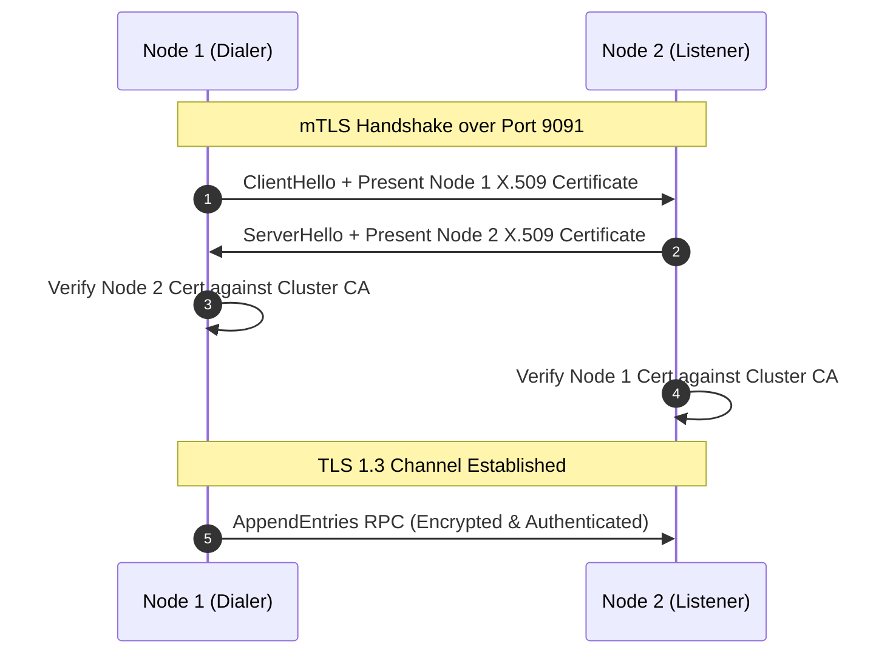
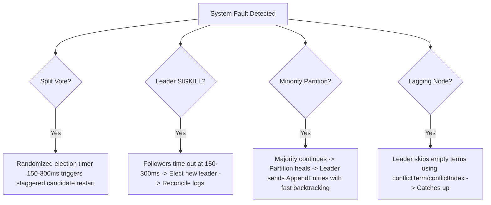

# Security, Threat Modeling & Chaos Recovery Guide
## Project: RaftLite — Distributed Consensus & Replicated Key-Value Store
**Document Version:** 1.0.0  
**Target Release:** v1.0-GA  
**Status:** Approved for Implementation  
**Maintainer:** Security & Systems Architecture  

---

### 1. Threat Model & Fault Assumptions

#### 1.1 Crash-Fault-Tolerant (CFT) vs. Byzantine Model
RaftLite is engineered strictly under the **Crash-Fault-Tolerant (CFT)** model (as formalized by Lamport, Ongaro, and Ousterhout), not a Byzantine Fault Tolerant (BFT) model.

```
+------------------------------------+------------------------------------+
| Included in Threat Model (CFT)     | Excluded from Threat Model (BFT)   |
+------------------------------------+------------------------------------+
| - Unannounced node crashes (SIGKILL) | - Cryptographic forgery / spoofing |
| - Asymmetric network partitions    | - Intentional malicious consensus  |
| - Arbitrary packet loss and delay  |   disruption / lying nodes         |
| - Out-of-order message delivery    | - Compromised memory / state       |
| - Duplicate message delivery       |   corruption by bad actors         |
| - Power loss / partial disk writes | - Rogue cluster nodes injecting    |
|   (torn writes)                    |   falsified election votes         |
+------------------------------------+------------------------------------+
```

#### 1.2 Core Trust Boundaries
1. **Intra-Cluster Network:** All RaftLite nodes in a cluster operate inside a trusted private control plane network (e.g., VPC, Kubernetes pod network, or private Docker bridge).
2. **Client Network:** Untrusted or semi-trusted applications connect strictly through the Client KV gRPC port (default `:8080`), never directly to the peer consensus port (default `:9090`).
3. **Local Storage:** The host operating system and block storage devices are assumed to adhere to standard POSIX `fsync` contract semantics.

---

### 2. Transport Security & Cluster Isolation

#### 2.1 Mutual TLS (mTLS) for Inter-Node Consensus
To ensure cluster isolation and prevent unauthorized nodes from joining the Raft quorum, all peer-to-peer gRPC channels support mutual TLS authentication:
- **Cluster Root Certificate Authority (CA):** Each cluster is provisioned with a private CA.
- **Node Certificates:** Each node presents a certificate signed by the cluster CA containing its unique Node ID in the Subject Alternative Name (SAN).
- **Mutual Verification:** During the TLS handshake, both dialing and receiving nodes verify that the peer's certificate was issued by the trusted CA and matches a configured peer identity.



#### 2.2 Shared Cluster Isolation Token
In environments where mTLS infrastructure is not active (such as local development or containerized test harnesses), RaftLite mandates a **Cluster Isolation Token**:
- Inter-node requests must include a gRPC metadata header: `x-raftlite-cluster-token: <shared-secret>`.
- Any incoming `RequestVote` or `AppendEntries` RPC with a missing or mismatched token is rejected immediately with status `codes.Unauthenticated`.

#### 2.3 Network Port Segregation
- **Consensus Port (`9091–9095`):** Strictly internal; bound to private cluster network interfaces. Exposes only `raftlite.v1.RaftService`.
- **Client Port (`8081–8085`):** Bound to public or service-mesh ingress interfaces. Exposes only `raftlite.v1.KVService`. Client requests cannot trigger internal consensus state transitions directly.

---

### 3. Storage Integrity, Tamper Detection & Crash Recovery

#### 3.1 CRC32 Checksumming & Bit-Rot Protection
Modern SSD and HDD storage can suffer from silent bit-rot, controller bugs, or storage corruption. Every frame written to the RaftLite WAL begins with an IEEE 32-bit CRC:
- **Calculation:** $\text{CRC32} = \text{crc32.ChecksumIEEE}(\text{PayloadBytes})$
- **Verification:** During sequential WAL replay on boot, every frame's checksum is recomputed. If the stored CRC32 does not match the computed CRC32, the node detects corruption immediately.

#### 3.2 Torn Write Recovery Algorithm
A **torn write** occurs when a server suffers power loss or `SIGKILL` while the operating system kernel is midway through flushing a write buffer to physical storage.

```
WAL on Disk after Crash midway through Frame 3:
+-------------------+-------------------+-----------------------------+
| Frame 1 (Valid)   | Frame 2 (Valid)   | Frame 3 (TORN WRITE - 11 B) |
| CRC OK | Complete | CRC OK | Complete | Incomplete Header / Corrupt |
+-------------------+-------------------+-----------------------------+
^                                       ^
Offset 0                                Offset: lastValidOffset
```

**Recovery Procedure:**
1. Open the WAL file in read-write mode (`os.O_RDWR`).
2. Read frames sequentially from offset 0.
3. If an incomplete header ($< 25$ bytes) is encountered:
   - Record current file offset as `lastValidOffset`.
   - Execute `os.Truncate(walPath, lastValidOffset)`.
   - Log recovery event: `"Torn write detected: truncated file at offset %d"`.
4. If a full header is read, but remaining file bytes $< \text{CmdLen}$:
   - Execute `os.Truncate(walPath, lastValidOffset)`.
5. If header and payload are read, but `computedCRC != storedCRC`:
   - Execute `os.Truncate(walPath, lastValidOffset)`.
6. Result: The node restores to the exact state of the last successfully flushed and synced frame, preserving log invariants.

#### 3.3 Metadata Atomic Updates
The persistent metadata file (`metadata.json`) containing `currentTerm` and `votedFor` must never suffer corruption. It is updated via the **atomic file replacement** pattern:
1. Serialize metadata to temporary file `metadata.json.tmp`.
2. Execute `file.Sync()` on the temporary file.
3. Call `os.Rename("metadata.json.tmp", "metadata.json")`. Under POSIX, rename is an atomic filesystem operation.

---

### 4. Threat Vectors, Protocol Edge Cases & Mitigations

#### 4.1 Split-Brain Prevention (Quorum Intersection)
- **Threat:** A network partition splits a 5-node cluster into two sub-clusters: $\{N_1, N_2\}$ and $\{N_3, N_4, N_5\}$. If both sides could elect a leader, data divergence would occur.
- **Mitigation:** Raft guarantees that any valid election requires a strict majority quorum:
  $$Q = \left\lfloor \frac{N}{2} \right\rfloor + 1$$
  - Sub-cluster $\{N_1, N_2\}$ has size 2. Required quorum for $N=5$ is 3. Neither $N_1$ nor $N_2$ can ever collect 3 votes.
  - Sub-cluster $\{N_3, N_4, N_5\}$ has size 3. It reaches quorum, elects a single leader, and processes writes normally.
  - Mathematical guarantee: Any two quorums must intersect in at least one node ($\{N_1, N_2, N_3\} \cap \{N_3, N_4, N_5\} = \{N_3\}$), preventing dual leaders in the same term.

#### 4.2 Prevention of Stale Reads
- **Threat:** A leader $L_1$ is partitioned from the majority, but has not yet realized it because its election timer has not expired. A client sends a `Get` request to $L_1$. If $L_1$ responds immediately from local memory, the client receives stale data.
- **Mitigation in v1:**
  - All read requests (`ClientGet`) are routed through the consensus pipeline as a log entry, or the leader must execute a round of heartbeats confirming its majority leadership before returning the read response (Read Index protocol).
  - Clients receive an explicit error (`codes.Unavailable: not the leader`) if a node is not the active, confirmed leader.

#### 4.3 Uncommitted Log Overwriting (Raft Safety Invariant §5.4.2)
- **Threat:** An old leader proposed entries in term 2, crashed, recovered in term 4, and attempts to commit term 2 entries simply because they are stored on a majority of nodes. If another node had committed a different entry in term 3, data would be overwritten.
- **Mitigation:** RaftLite strictly enforces Ongaro's Rule (§5.4.2):
  - A leader *never* commits log entries from previous terms by counting replicas.
  - Only log entries from the leader's **current term** are committed by counting replicas.
  - Once an entry from the current term is committed by majority quorum, all preceding entries in the log are committed indirectly.

#### 4.4 Client Request Duplication & Replay Attacks
- **Threat:** A client sends `CAS(key="balance", expected="100", new="150", seq=10)`. The leader commits the entry and mutates the KV state, but the network connection drops before the ACK reaches the client. The client retries the exact request. If re-executed, the CAS fails because balance is now `150`.
- **Mitigation:** The Client Deduplication Table (`pkg/kv/session.go`):
  - Tracks `lastSeq` per `clientId`.
  - When sequence 10 is re-received, the state machine recognizes that sequence 10 has already been executed.
  - It bypasses the mutation and returns the cached response from sequence 10, preserving idempotence and linearizability.

---

### 5. Failure Modes, Chaos & Operator Recovery Playbook



#### Detailed Scenario Playbook:

| Failure Scenario | Immediate System Behavior | Automated Recovery Path | Operator Action Required |
| :--- | :--- | :--- | :--- |
| **Leader SIGKILL / Sudden Power Outage** | Heartbeats cease. Followers' randomized election timers (150ms–300ms) expire. | Staggered election timers ensure one follower converts to Candidate first, requests votes, achieves quorum, and broadcasts heartbeats. Failover completes in $< 150$ms. | None. Automated self-healing. |
| **Split Vote (Simultaneous Candidates)** | Two nodes become Candidates at the same millisecond; each receives equal votes (e.g., 2 votes each in 4-node group). | Neither candidate reaches quorum. Randomized election timeouts (150–300ms) ensure one candidate's timer expires earlier, starting term $T+1$ and winning quorum. | None. Automated self-healing. |
| **Minority Network Partition** | Nodes $\{N_1, N_2\}$ cannot reach $\{N_3, N_4, N_5\}$. | $\{N_1, N_2\}$ reject writes (cannot reach quorum). $\{N_3, N_4, N_5\}$ elect a leader and continue serving traffic. Upon partition heal, $N_1$ and $N_2$ adopt the new term, reconcile uncommitted logs, and catch up. | None. Monitor network infrastructure. |
| **Lagging Node Reconnection** | Node was disconnected for hours; thousands of log entries have passed. | When the node reconnects, the leader attempts `AppendEntries`. Using **fast conflict backtracking**, the leader skips entire conflicting terms in single round-trips to locate the matching index, streaming log entries until caught up. | Ensure adequate network bandwidth for log catchup. |
| **Disk Corruption on Node Boot** | Node restarts after hard power cut; WAL contains a corrupted tail record. | The node executes WAL recovery, computes CRC32, identifies the corrupt frame, truncates the file at `lastValidOffset`, and joins the cluster as a follower. | None. Recovery is self-contained and logged. |
